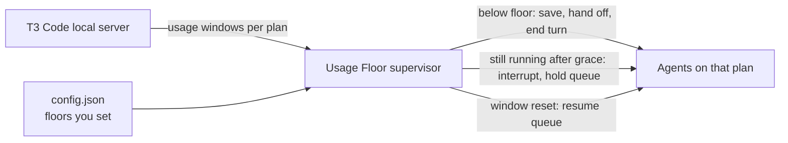

# Usage Floor

[](pyproject.toml)
[](LICENSE)

Keep a usage reserve on every AI subscription plan your [T3 Code](https://github.com/pingdotgg/t3code)
agents run on. When a plan drops below the floor you set, Usage Floor tells the agents on it to save their work
and stop, and it resumes them when the usage window resets.

```text
Supervisor: running (pid 53928)   Enforcement: on   Start at sign-in: yes   Last check: 1 min ago
------------------------------------------------------------------------------------------------
 1. Personal  [ChatGPT Pro Subscription]
      - Weekly                              82.0% left   floor 80%   resets 24 Nov '26, 19:30 (in 6 days)
 2. Claude  [Claude Pro Subscription]
      - Session                             62.0% left   no floor    resets 18 Nov '26, 22:49 (in 3 h 53 min)
      - Weekly                              55.0% left   floor 40%   resets 23 Nov '26, 20:29 (in 5 days)
 3. Antigravity  [Google account]
      - Gemini - 5-hour                     40.8% left   no floor    resets 18 Nov '26, 19:26 (in 30 min)
------------------------------------------------------------------------------------------------
 1  Set a floor        2  Remove a plan's floors     3  Refresh
 4  Start supervisor   5  Stop supervisor            6  Start at sign-in on/off
 7  Enforcement on/off (keeps floors)   8  Grace minutes (now 10)   0  Exit
```

## Why

Long-running orchestrators and their sub-agents can drain a weekly subscription window overnight, leaving nothing
for the work you do by hand. Asking agents to watch their own quota does not hold up: they forget the rule, misread
an unavailable reading as "out of quota" and stop early, or keep going past the limit. Usage Floor moves the rule
out of the prompt and into a small supervisor that reads the real numbers.

## How it works



Every two minutes the supervisor reads each plan's usage windows (session, weekly and so on) from T3 Code's local
server and compares the unused share with the floor you set for that window. Reset times are shown as
`24 Nov '26, 19:30 (in 6 days)` in your local time zone.

1. **Floor reached.** Every agent running on that plan receives a message: save or commit, write a short handoff,
   and end the turn. Plans on other accounts are never touched.
2. **Grace period over (10 minutes by default).** Runs still going are interrupted and their queues are held. Any
   new run that starts on a parked plan is interrupted straight away.
3. **Floor lifted.** When the window resets, or you lower or remove the floor, held queues resume and parked
   threads are told to continue from their handoff.

Safety rules:

- A missing usage reading, or one older than 20 minutes, never counts as below the floor.
- Usage Floor only steers, interrupts and resumes runs through T3 Code. It never deletes threads, edits files or
  changes provider settings.
- It does not modify T3 Code. It talks to the same local server the T3 Code app uses, with a ten-minute token scoped
  to reading and operating threads, revoked after each pass.

## Requirements

- [T3 Code](https://github.com/pingdotgg/t3code) running on the same machine, with its `t3` CLI available.
- Python 3.11 or newer. No third-party packages.
- Windows 10 or 11 for the background supervisor and start at sign-in. The menu and policy run anywhere.

## Install

```powershell
pipx install git+https://github.com/shreyasjswork/usage-floor
```

Or with pip in any Python 3.11+ environment:

```powershell
python -m pip install git+https://github.com/shreyasjswork/usage-floor
```

## Use

```powershell
usage-floor              # open the menu
usage-floor start        # start the supervisor in the background (no window)
usage-floor autostart on # start it at every sign-in
usage-floor status       # settings, state and supervisor status as JSON
usage-floor run --dry-run  # show what the supervisor would do right now, without acting
usage-floor stop
```

In the menu, press **1**, pick a plan, pick a window (or `a` for all of them) and enter the share to keep unused.
For example, `80` parks the plan's agents once 20% of that window is used. Floors stay until you change them.

### What agents see

> Usage floor reached for Personal (ChatGPT Pro Subscription): Weekly 79.0% left (floor 80%). Stop starting new
> work on this plan. Within 10 minutes: commit or save your current state, write a short handoff of what remains
> (files, next step), and end this turn. Do not launch new agents on this plan; Usage Floor resumes this thread when
> the floor lifts.

If your agents follow shared instructions (an `AGENTS.md` or similar), tell them that Usage Floor is the only quota
gate and that they should follow its message rather than enforce reserves themselves.

## Configuration

Settings live in `config.json` inside the data folder:

```json
{
  "version": 1,
  "enabled": true,
  "graceMinutes": 10,
  "resumeOnLift": true,
  "plans": {
    "codex": { "name": "Personal", "plan": "ChatGPT Pro Subscription", "floors": { "primary": 80 } }
  }
}
```

`plans` is keyed by T3 provider instance; `floors` maps a usage window id to the minimum unused percentage.
The supervisor also writes `state.json` (current blocks and parked threads) and `events.jsonl` (an audit log of
every warning, interrupt and resume).

| Environment variable  | Purpose                  | Default                                                              |
| --------------------- | ------------------------ | -------------------------------------------------------------------- |
| `USAGE_FLOOR_HOME`    | Data folder              | `%LOCALAPPDATA%\usage-floor` (Windows), `~/.local/state/usage-floor` |
| `USAGE_FLOOR_T3_HOME` | T3 Code home folder      | `T3CODE_HOME`, else `~/.t3`                                          |
| `USAGE_FLOOR_T3_CLI`  | Path to the `t3` CLI     | `T3CODE_CLI_PATH`, else `t3` on `PATH`, else `<T3 home>/bin/t3`      |

## Limitations

- Usage Floor relies on T3 Code's internal local RPC (`server.getConfig`, `orchestration.dispatchCommand`) and its
  state database. These are not a published API and may change between T3 Code releases.
- It can only enforce plans for which T3 Code reports usage windows. OpenCode plans currently report none.
- Antigravity 1.5.x stores one Google sign-in for every instance, so several Antigravity instances may share one
  account while showing different meters ([pingdotgg/t3code#37587](https://github.com/pingdotgg/t3code/issues/37587)).
- Interrupting a run stops it mid-turn. The grace period exists so agents can reach a clean stopping point first.

## Development

```powershell
git clone https://github.com/shreyasjswork/usage-floor
cd usage-floor
python -m pip install -e . pytest ruff
python -m pytest
ruff check .
```

The decision logic lives in [`policy.py`](src/usage_floor/policy.py) and has no I/O, so every rule is covered by
plain unit tests. [`t3.py`](src/usage_floor/t3.py) holds the T3 Code client and
[`supervisor.py`](src/usage_floor/supervisor.py) wires the two together.

## License

[MIT](LICENSE). Usage Floor is an independent project and is not affiliated with or endorsed by T3 Code or ping.gg.
